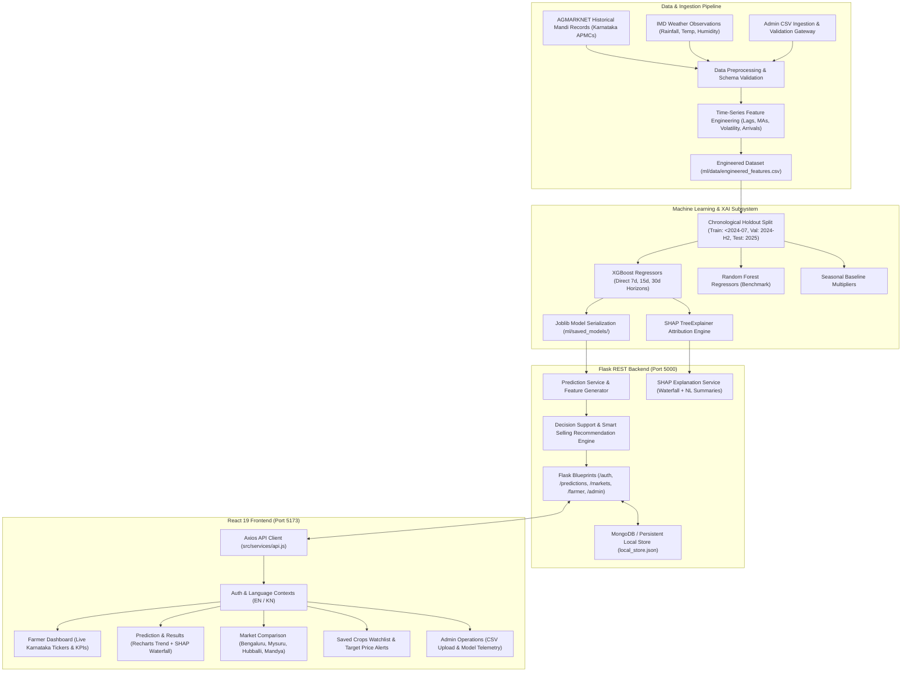

# System Architecture & Technical Specification

## 1. High-Level Architectural Diagram

---

## 2. SHAP Explainability & Additivity Axiom

For any tree-based prediction $\hat{y} = f(x)$, the SHAP attribution guarantees:

$$\hat{y} = \phi_0 + \sum_{i=1}^{M} \phi_i(x)$$

Where:
- $\phi_0 = \mathbb{E}[f(x)]$: The expected baseline price across Karnataka APMC mandis (approx. ₹2,514.70/quintal).
- $\phi_i(x)$: The marginal contribution of feature $i$ in ₹/quintal.
- Reconciled difference $|\hat{y} - (\phi_0 + \sum \phi_i)| < 0.001$, verified dynamically on every prediction.

---

## 3. Decision-Support Engine Formulation

The recommendation engine computes the estimated net economic gain:

$$\Delta P_{net} = (P_{pred} - P_{curr}) - (H \times C_{storage}) - (P_{curr} \times R_{spoilage}) - C_{transport}$$

Where:
- $P_{curr}$: Current mandi modal price.
- $P_{pred}$: Horizon-predicted future price ($H \in \{7, 15, 30\}$ days).
- $C_{storage}$: Daily crop holding expense (INR / quintal / day).
- $R_{spoilage}$: Expected loss percentage based on ambient crop shelf life (e.g. 12% per week for Tomato without cold storage).
- $C_{transport}$: Freight cost per quintal from farm-gate to destination APMC.

### Recommendation Policies:
1. **Consider Selling Now:** If $\Delta P_{net} \le 0$, or if farmer urgency is "High", or if horizon $H >$ ambient shelf life for perishable crops without cold storage.
2. **Consider Waiting:** If $\Delta P_{net} > 0$ and net percentage gain $\ge 4.0\%$, with shelf life $\ge H$.
3. **Monitor Market Conditions:** If net price delta is marginal (between $-2\%$ and $+4\%$).
